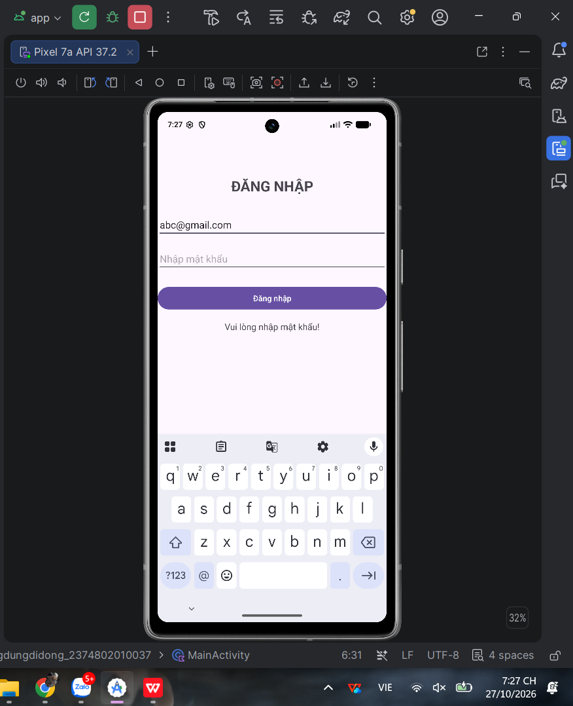
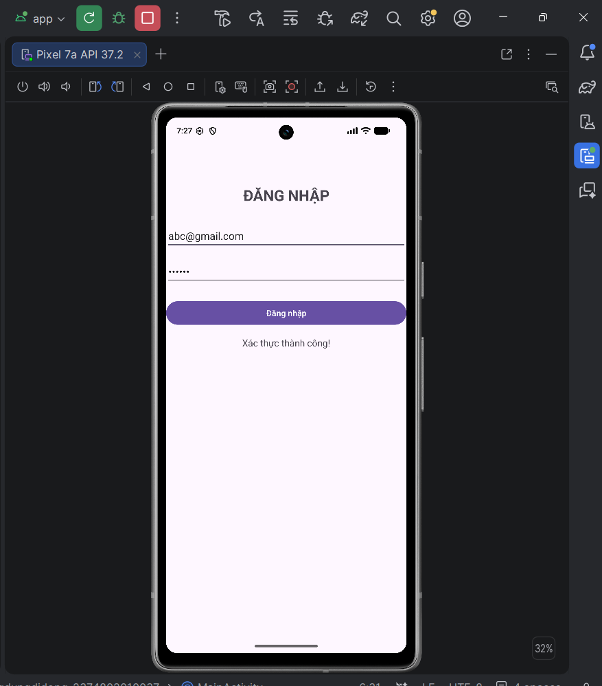
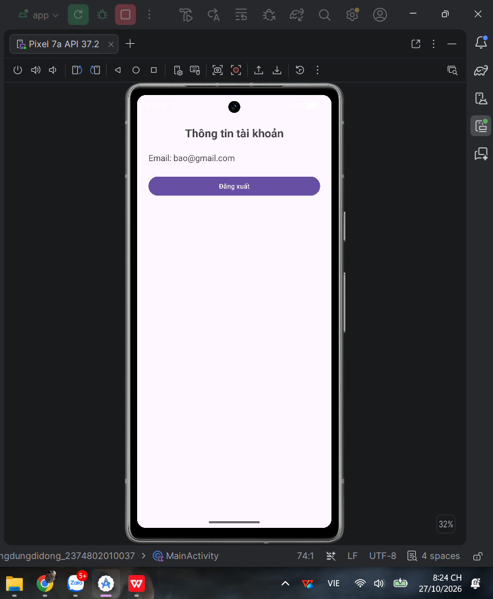
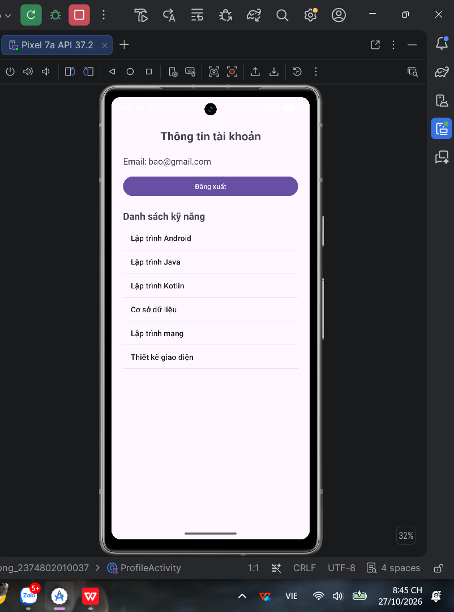
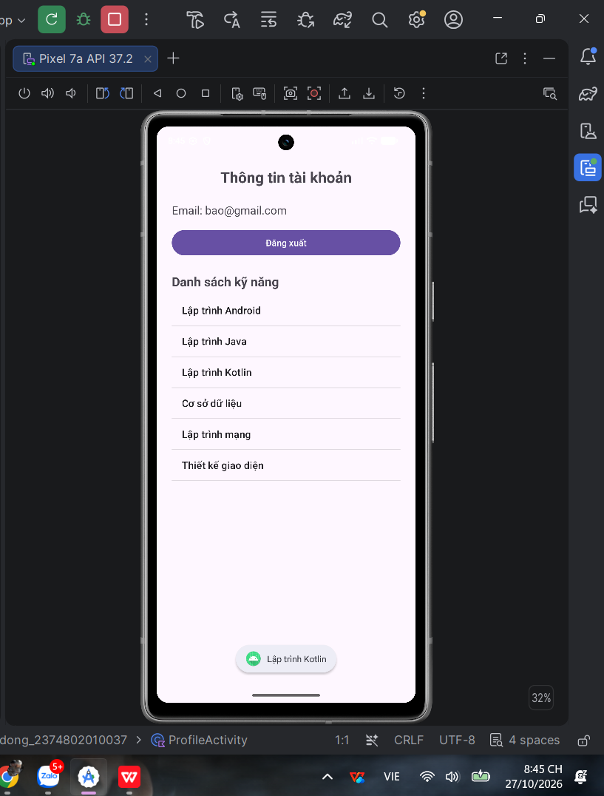

# BÀI THI THỰC HÀNH – LẬP TRÌNH ỨNG DỤNG DI ĐỘNG

- **Họ và tên:** Nguyễn Gia Bảo
- **MSSV:** 2374802010037

## Câu 1: Login và Validation

### 1. Validation Error

### 2. Validation Success

## Câu 2: Activity và Intent
Sử dụng Intent tường minh để chuyển từ màn hình đăng nhập sang màn hình thông tin tài khoản. 
Email được truyền bằng `putExtra()` và nhận bằng `getStringExtra()`. 
Nhấn nút Đăng xuất để quay lại màn hình đăng nhập.

## Câu 3: ListView và Adapter

Sử dụng ListView và ArrayAdapter để hiển thị danh sách kỹ năng. Khi chọn một mục, ứng dụng hiển thị Toast chứa tên kỹ năng được chọn.

### 1. Danh sách kỹ năng

### 2. Toast khi chọn mục

